# FRC Vision Scout

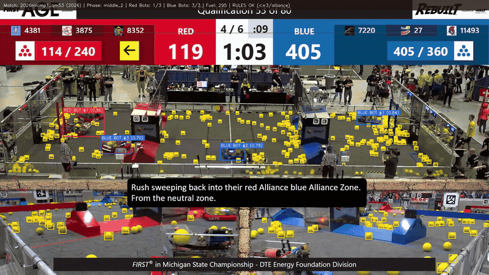

**YOLO11 bumper and fuel detector for FRC 2026 (REBUILT), trained entirely on synthetic Blender renders.**

[](LICENSE)
[](https://www.python.org/)
[](https://docs.ultralytics.com/)
[](https://www.blender.org/)

---

## Results

### Synthetic Validation (872 images, 90,993 boxes)

| Metric | Value |
|--------|-------|
| **Precision** | 98.2% |
| **Recall** | 94.1% |
| **mAP@50** | 96.3% |
| **mAP@50-95** | 80.1% |

*Best checkpoint at epoch 99 (patience 20, final epoch 119).*

| Class | mAP@50 | Confusion Matrix Diagonal |
|-------|--------|---------------------------|
| Red Bumper | 0.989 | 0.98 |
| Blue Bumper | 0.989 | 0.99 |
| Fuel | 0.911 | 0.91 |

### Real Footage Validation (Zero Labels)

| Metric | Value |
|--------|-------|
| Keyframes evaluated | 775 (155 matches, 130 events) |
| Bounding boxes analyzed | 103,816 |
| Red alliance ≤3 robots compliance | 95.87% |
| Blue alliance ≤3 robots compliance | 96.52% |
| In-field detection precision | 99.90% |
| HSV bumper color purity | 97.83% |
| Robots tracked | 48 (45 unique teams) |
| Playstyle clusters | k=6, silhouette 0.250 |

*Metrics from [validation/ANALYTICS_REPORT.md](validation/ANALYTICS_REPORT.md)*

---

## Pipeline

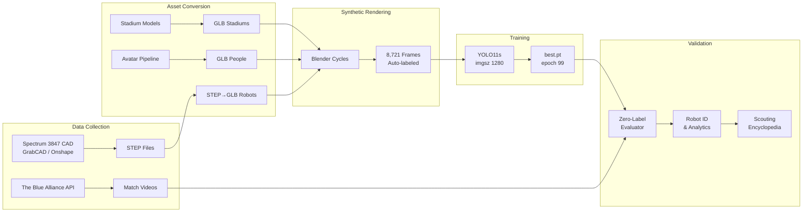

---

## Synthetic vs. Real

<table>
<tr>
<td><strong>Synthetic Render</strong></td>
<td><strong>Real Match Detection</strong></td>
</tr>
<tr>
<td>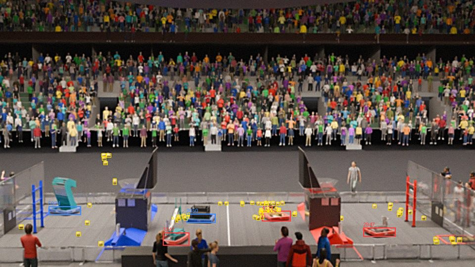</td>
<td>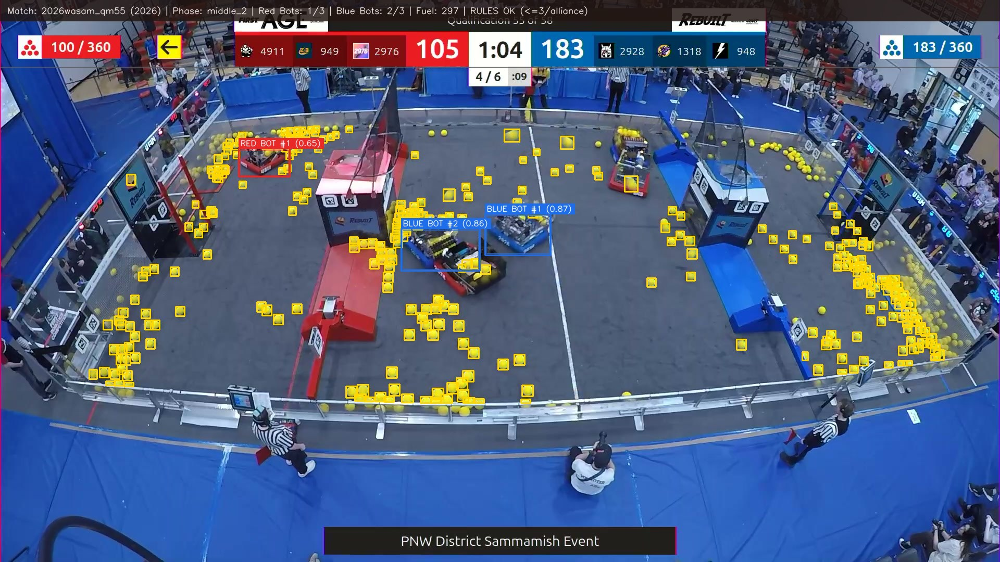</td>
</tr>
<tr>
<td>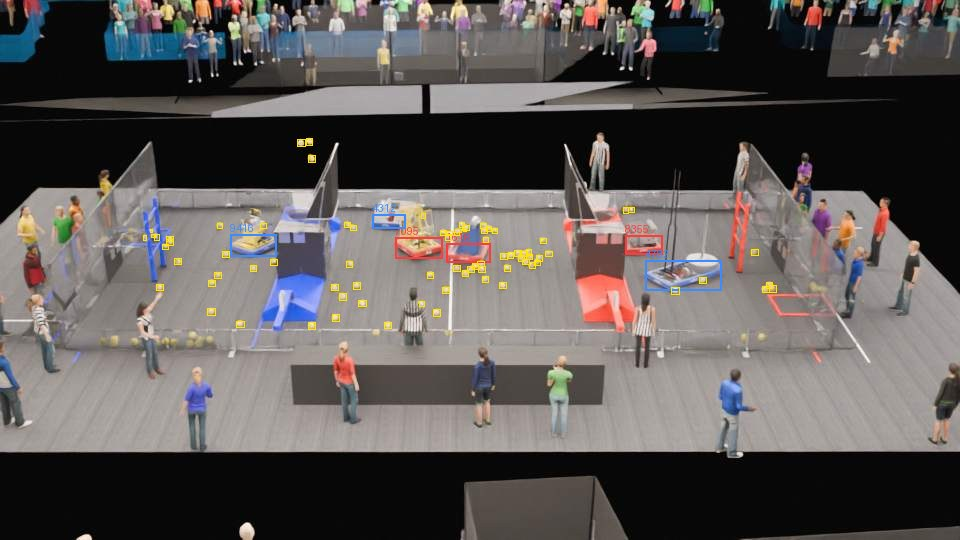</td>
<td>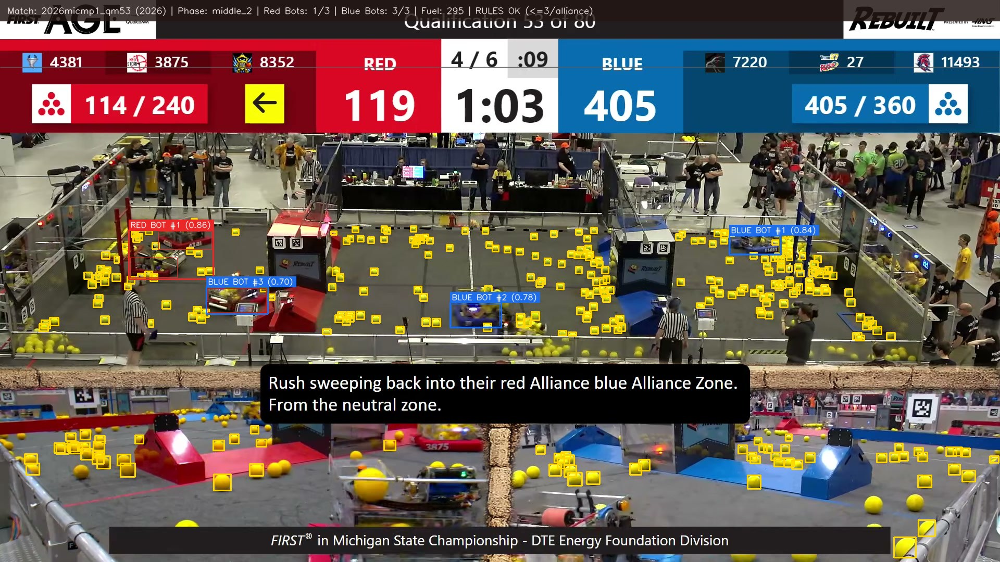</td>
</tr>
</table>

---

## Training Curves

<table>
<tr>
<td>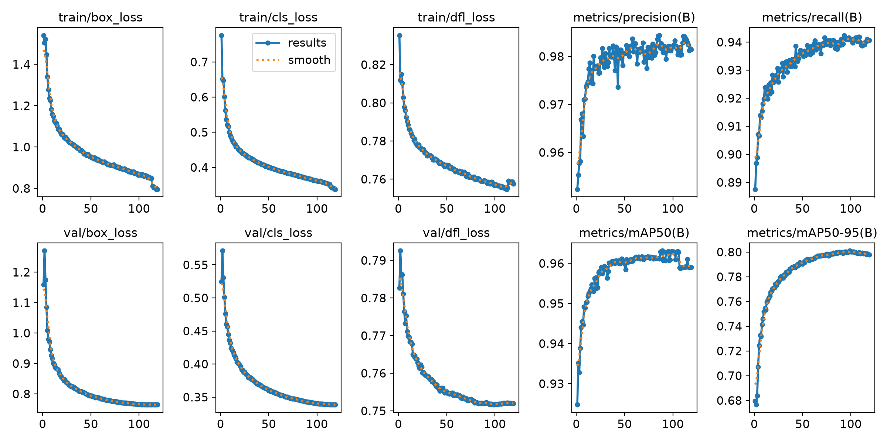</td>
<td>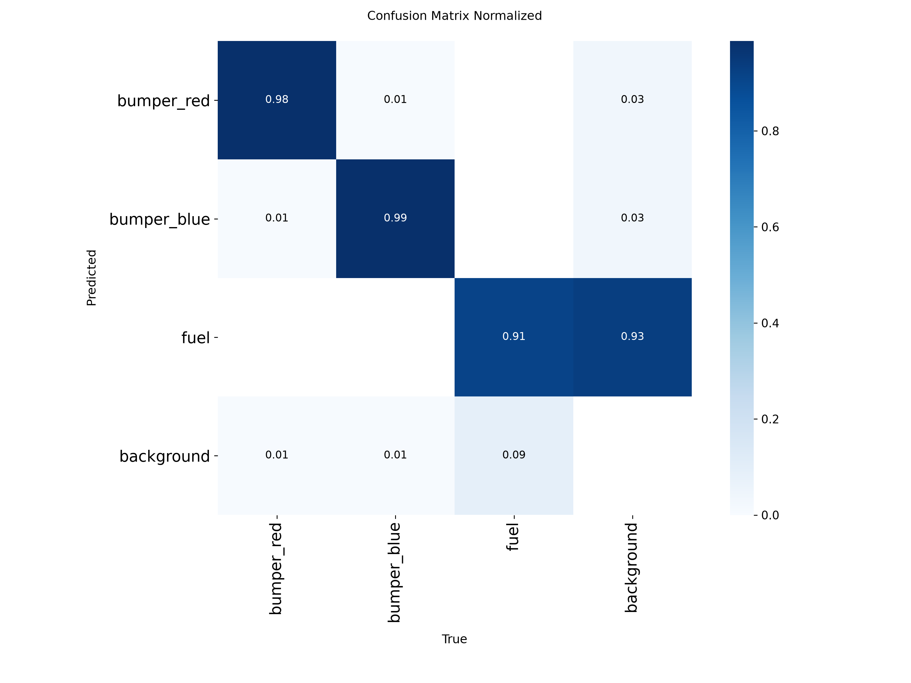</td>
</tr>
<tr>
<td>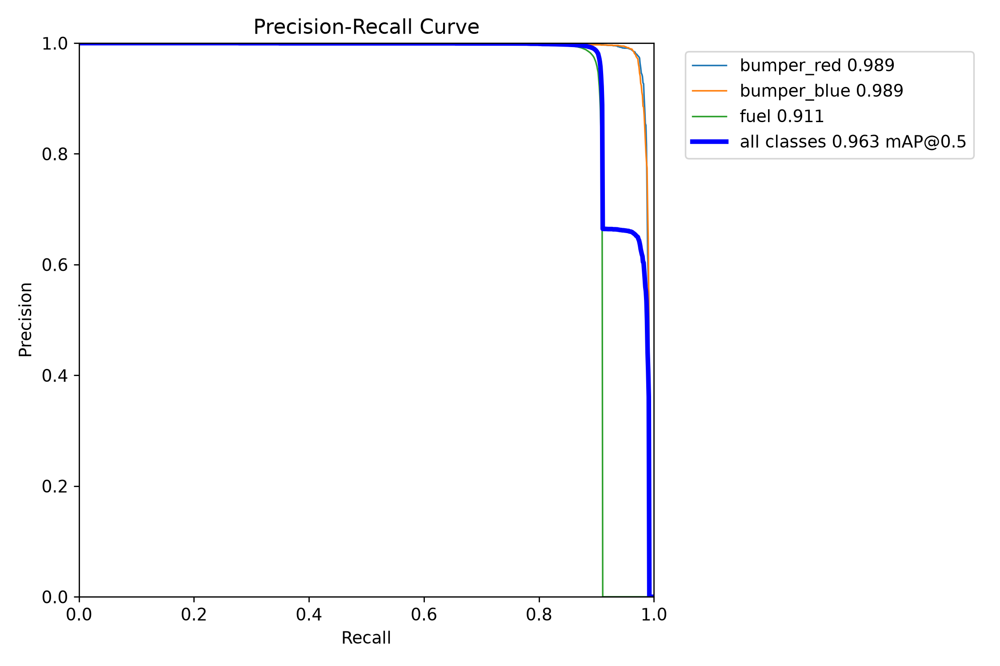</td>
<td>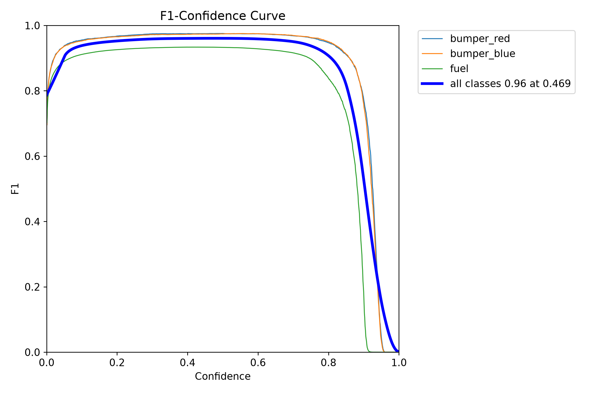</td>
</tr>
</table>

---

## Real Footage Analytics

<table>
<tr>
<td>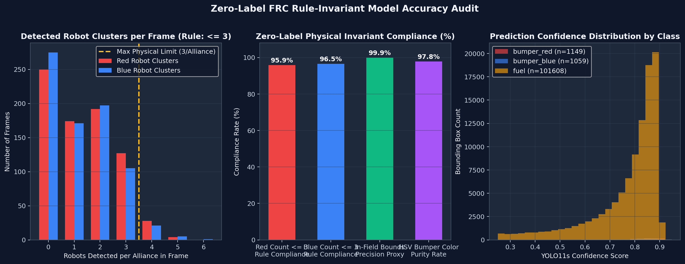</td>
<td>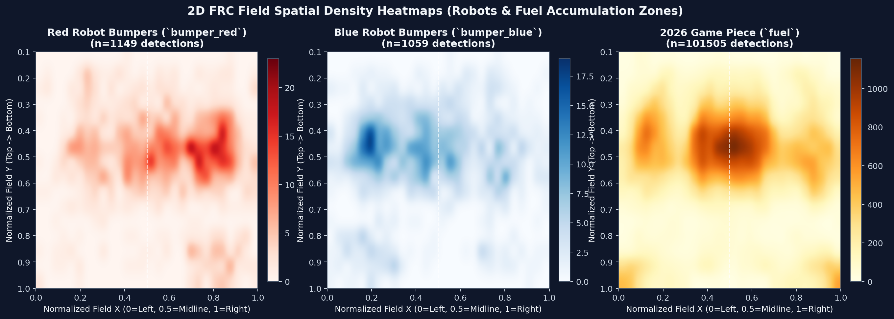</td>
</tr>
<tr>
<td>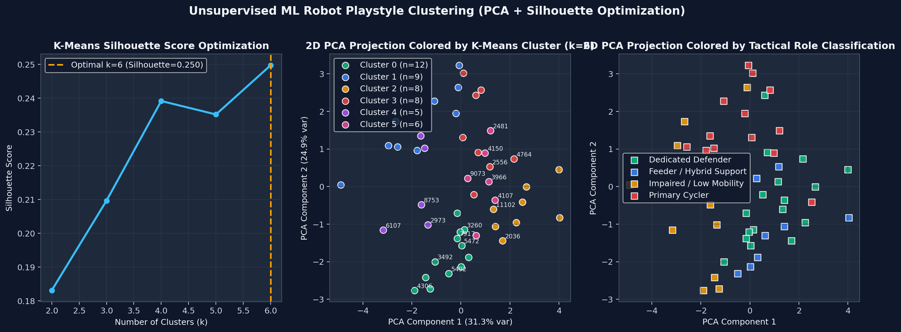</td>
<td>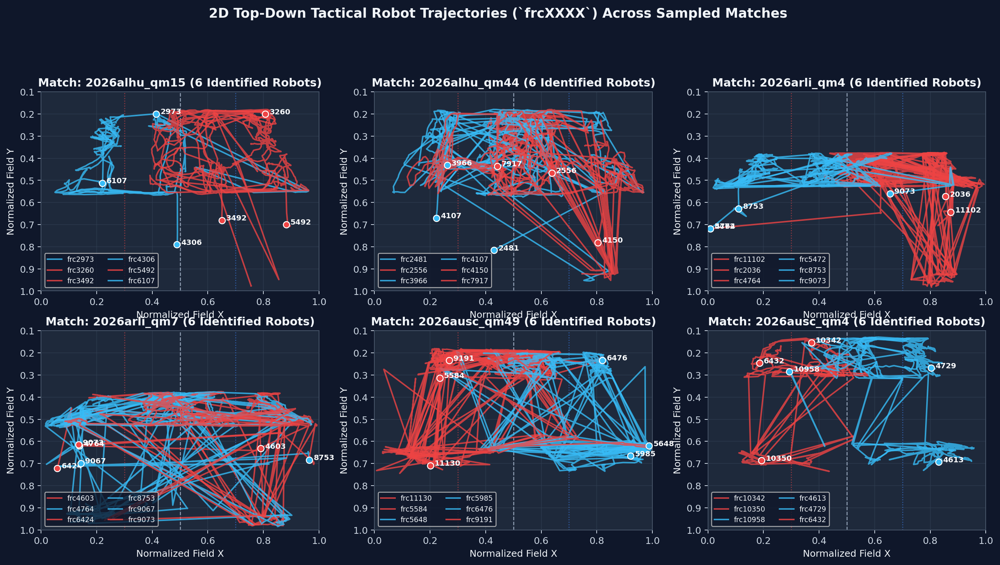</td>
</tr>
</table>

See [validation/ANALYTICS_REPORT.md](validation/ANALYTICS_REPORT.md) for the full report and [validation/ROBOT_SCOUTING_ENCYCLOPEDIA.md](validation/ROBOT_SCOUTING_ENCYCLOPEDIA.md) for per-robot dossiers.

---

## Repository Layout

```
frc-vision-scout/
├── data_collection/          # CAD scrapers & TBA video downloader
│   ├── frc_cad/              # Onshape/GrabCAD STEP downloader
│   └── tba/                  # The Blue Alliance match video notebook
├── assets/                   # STEP→GLB converters for robots, stadiums, people
│   └── people/               # Avatar/field-staff pipeline
├── render/                   # Blender scene randomizer & cloud GPU scripts
│   ├── assets/               # Textures, fonts, carpet
│   ├── crowd/                # Crowd proxy builder
│   └── examples/             # Sample frame JSON + plot
├── training/                 # Training notebook & data.yaml
├── validation/               # Real-match analytics code & reports
│   ├── code_snapshot/        # Evaluator, robot identifier, diagnostics
│   ├── data/                 # Evaluation CSVs/JSONs
│   └── robot_profiles/       # Per-robot scouting folders
├── results/
│   ├── training/             # Ultralytics outputs (curves, matrices)
│   └── charts/               # Analytics visualization charts
├── dataset_sample/           # 72-frame sample (val split)
│   ├── images/
│   └── labels/
└── docs/media/               # README images & GIF
```

---

## Quickstart

### Prerequisites
- Python 3.10+
- Blender 4.5 (for rendering)
- CUDA GPU (for training and inference)

### Environment Setup

```bash
git clone https://github.com/TheRollerBlader/frc-vision-scout.git
cd frc-vision-scout

# Create environment
python3 -m venv .venv
source .venv/bin/activate

# Install dependencies (validation pipeline)
pip install -r validation/code_snapshot/requirements.txt

# For rendering, see render/setup.sh
```

### Environment Variables

Copy `.env.example` and fill in your credentials:

```bash
cp .env.example .env
```

Required for various components:
- `ONSHAPE_EMAIL`, `ONSHAPE_PASSWORD` — Onshape CAD export
- `TBA_KEY` — The Blue Alliance API
- `RUNPOD_API_KEY` — Cloud GPU rendering

### Reproduce the Pipeline

1. **Data Collection**: See [data_collection/README.md](data_collection/README.md) for scraping robot CAD and downloading match videos.

2. **Asset Conversion**: Convert STEP→GLB with the scripts in [assets/](assets/README.md).

3. **Rendering**: Run the Blender pipeline on cloud GPUs — see [render/README.md](render/README.md).

4. **Training**: Use `training/train_frc.ipynb` on a GPU instance with the full dataset from Google Drive.

5. **Validation**: Run the analytics pipeline:
   ```bash
   cd validation/code_snapshot
   python run_vision_pipeline.py --max-videos 15 --video-stride 5
   ```

### Trained Weights

**Weights are intentionally not published.** This repository is a portfolio showcase of the pipeline and methodology. To reproduce:
1. Download the full synthetic dataset from [Google Drive](https://drive.google.com/file/d/1nzFFk6rwvYjk1w75BH_ETWjsc_cy0sdU/view)
2. Train with `training/train_frc.ipynb`

---

## What I Learned

### Synthetic-to-Real Transfer
- Domain randomization works: randomizing cameras, lighting, crowds, and textures enabled zero-shot transfer to real FRC broadcasts
- Broadcast-style camera constraints (head-on, midfield) were critical for sim-to-real alignment
- The model generalizes across 5+ years of FRC footage despite training only on 2026 synthetic data

### Technical Challenges
- **Blender CPU bottleneck**: Scene setup (importing models, crowd instancing) dominated render time at ~17-25s per frame, with only ~5s of actual GPU rendering
- **Bumper occlusion**: Split bumpers (partially hidden by people/robots) required careful label handling
- **Fuel false positives**: The "fuel" class had the lowest accuracy (0.911 mAP@50) — background objects occasionally triggered false detections

### Limitations
- Trained only on synthetic data; no real-world fine-tuning
- Robot Re-ID depends on TBA match data for the closed-set constraint
- Fuel detection struggles in older seasons where game pieces had different colors
- No tracking across camera cuts in broadcast footage

### Next Steps
- Active learning: use `validation/data/active_learning_hardest_50_frames.csv` to label hard examples
- Multi-camera tracking with temporal consistency
- Expand to other FRC game pieces across seasons
- Real-time inference for live scouting applications

---

## Dataset & Resources

| Resource | Size | Link |
|----------|------|------|
| Full synthetic dataset | 4.45 GB | [Google Drive](https://drive.google.com/file/d/1nzFFk6rwvYjk1w75BH_ETWjsc_cy0sdU/view) |
| YOLO split (train/val) | 3.90 GB | [Google Drive](https://drive.google.com/file/d/1YgHrvRYdsSVqIAC-XK0UlefKavIEfXAx/view) |
| Training run artifacts | 660.8 MB | [Google Drive](https://drive.google.com/file/d/1KTX1253XAXCc0UrntpS0hexg83fnO0iv/view) |

**Note**: Robot CAD belongs to the original FRC teams. Match broadcasts are property of FIRST and its partners.

---

## Rendering Stats

- **7 stadium environments** (arenas, hockey rinks, convention centers)
- **8,721 frames** rendered
- **~$25 of Runpod GPU time** (RTX PRO 4500, L4, RTX PRO 4000)
- **2-3 Blender instances per GPU** for throughput
- **17-25s per frame** (mostly CPU scene setup)

---

## Acknowledgements

- **[Spectrum 3847](https://spectrum3847.org/)** — FRC robot CAD collection
- **[The Blue Alliance](https://www.thebluealliance.com/)** — Match data API
- **[FIRST](https://www.firstinspires.org/)** — The inspiration behind it all
- **[Ultralytics](https://ultralytics.com/)** — YOLO11 framework
- **[ambientCG](https://ambientcg.com/)** & **[Poly Haven](https://polyhaven.com/)** — CC0 textures
- **[GrabCAD](https://grabcad.com/)** & **[Onshape](https://www.onshape.com/)** — CAD hosting platforms

---

## License

This project is licensed under the MIT License — see [LICENSE](LICENSE) for details.

**Krish Bharadiya** — 2026
