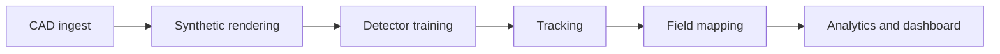

# frc-vision-scout

> Automatic FRC robot detection, tracking, and field heatmaps from match video.
> Created by **Krish Bharadiya** ([@TheRollerBlader](https://github.com/TheRollerBlader)).

<!-- TODO: demo GIF here (tracked bumpers + top-down field map) -->


## What it does
TODO: two sentences.

## Results
| Metric | Value |
|---|---|
| Detection mAP50 (real val set) | TBD |
| Tracking IDF1 | TBD |
| ID switches / match | TBD |
| Processing speed | TBD |

## Pipeline


## Quickstart
```bash
git clone https://github.com/TheRollerBlader/frc-vision-scout.git && cd frc-vision-scout
python3 -m venv .venv && source .venv/bin/activate
pip install -e ".[dev]"
frcscout --help
```

## Docs
- [Contributing and push guidelines](CONTRIBUTING.md)
- [Architecture](docs/architecture.md)
- [Data card](docs/data-card.md) | [Model card](docs/model-card.md)

## Roadmap
- [ ] v0.1.0 - NTX/STEMGals prototype
- [ ] On-robot real-time detection
- [ ] Moving-camera field mapping

## License and credit
Proprietary, all rights reserved. See [LICENSE](LICENSE) and [NOTICE](NOTICE).
Use of this project requires prominent credit to Krish Bharadiya.
