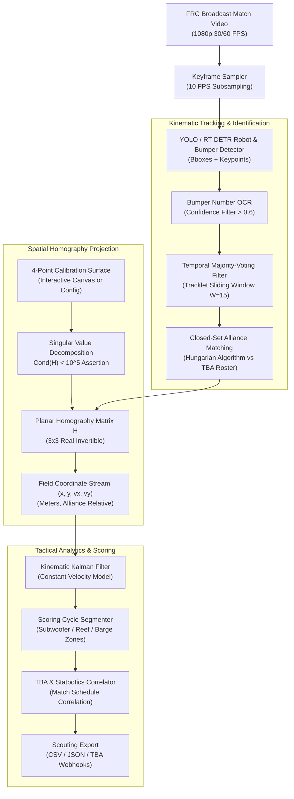

# Architecture Specification: FRC Vision Homography & Trajectory Analytics Pipeline

## 1. Executive Summary
`frc-vision-scout` autonomously transforms broadcast match footage from FIRST Robotics Competition (FRC) matches into verified robot spatial trajectories, auto-path replays, and cycle-time scoring analytics. This specification defines the mathematical homography calibration pipeline, temporal bumper filtering, and closed-set match synchronization.

---

## 2. Pipeline Architecture & Data Flow

---

## 3. Mathematical Foundations

### 3.1 Planar Field Homography Transform
Points from the camera pixel plane $\mathbf{x} = [u, v, 1]^T$ map to the real-world metric field plane $\mathbf{X} = [X, Y, 1]^T$ via a 3x3 projective transformation matrix $\mathbf{H}$:
$$\mathbf{X} \sim \mathbf{H} \mathbf{x} = \begin{bmatrix} h_{11} & h_{12} & h_{13} \\ h_{21} & h_{22} & h_{23} \\ h_{31} & h_{32} & h_{33} \end{bmatrix} \begin{bmatrix} u \\ v \\ 1 \end{bmatrix}$$
Normalized Euclidean metric coordinates are obtained via inhomogeneous division:
$$X = \frac{h_{11}u + h_{12}v + h_{13}}{h_{31}u + h_{32}v + h_{33}}, \quad Y = \frac{h_{21}u + h_{22}v + h_{23}}{h_{31}u + h_{32}v + h_{33}}$$

### 3.2 Calibration Numerical Conditioning
To prevent catastrophic projection distortion from near-collinear calibration points, the Singular Value Decomposition (SVD) of $\mathbf{H}$ is evaluated:
$$\mathbf{H} = \mathbf{U} \mathbf{\Sigma} \mathbf{V}^T, \quad \kappa(\mathbf{H}) = \frac{\sigma_{\max}}{\sigma_{\min}}$$
Any calibration setting with condition number $\kappa(\mathbf{H}) \ge 10^5$ is rejected as numerically ill-conditioned.

### 3.3 Temporal Bumper OCR Filter & Closed-Set Matching
During high-speed robot rotations or fabric wrinkle conditions, raw OCR predictions experience transient character drops.
* **Tracklet Buffer**: Each tracked bounding box maintains a window of the last $N = 15$ OCR readouts.
* **Weighted Voting**: Votes are weighted by detector confidence $c_t$:
  $$V(k) = \sum_{t=1}^N c_t \cdot \mathbb{I}(r_t = k)$$
* **Closed-Set Elimination**: Matches are constrained to the 6 known teams competing in the match (3 Red, 3 Blue) fetched from The Blue Alliance API, resolved via minimum-cost bipartite matching (Hungarian Algorithm).

---

## 4. Verification & Testing Guardrails
* **Pytest Test Suite**: `tests/test_homography.py`, `tests/test_calibration_schema.py`, `tests/test_bumper_filter.py`, `tests/test_robot_identifier.py`, `tests/test_tba_client.py`.
* **Coverage**: 38 unit tests verifying geometric stability, outlier velocity rejection, and TBA schema roundtrips.
