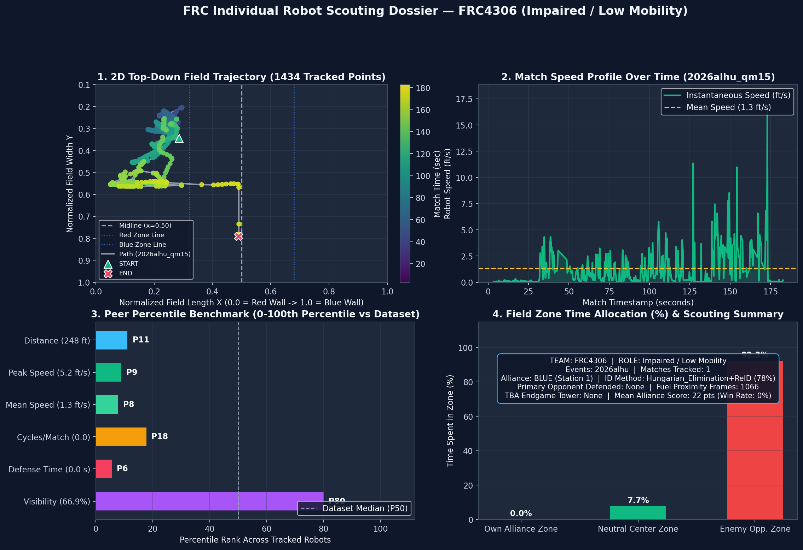

# FRC4306 — Individual FRC Vision Scouting Dossier

## 1. Executive Scouting Summary
- **Team Key**: `frc4306` (Team #4306)
- **Classified Tactical Role**: **Impaired / Low Mobility**
- **Event(s)**: `2026alhu` (1 full-video matches tracked)
- **Identification Confidence**: **78.0%** (`Hungarian_Elimination+ReID`)
- **Camera Visibility Rate**: **66.9%** of match duration

## 2. Kinematic & Gameplay Metrics
| Metric | Value | Peer Percentile |
| :--- | :---: | :---: |
| **Mean Distance Traveled** | **247.8 ft** | `P11` |
| **Mean Driving Speed** | **1.33 ft/s** | `P8` |
| **Peak Sprint Speed (95th %)** | **5.23 ft/s** | `P9` |
| **Estimated Cycles / Match** | **0.0** (0 total) | `P18` |
| **Defense Engagement Time** | **0.0 sec/match** | `P6` |
| **Field Zone Split (Own / Neutral / Enemy)** | **0.0% / 7.7% / 92.3%** | — |
| **Mean Alliance Final Score** | **22.0 pts** (Win Rate: 0%) | — |
